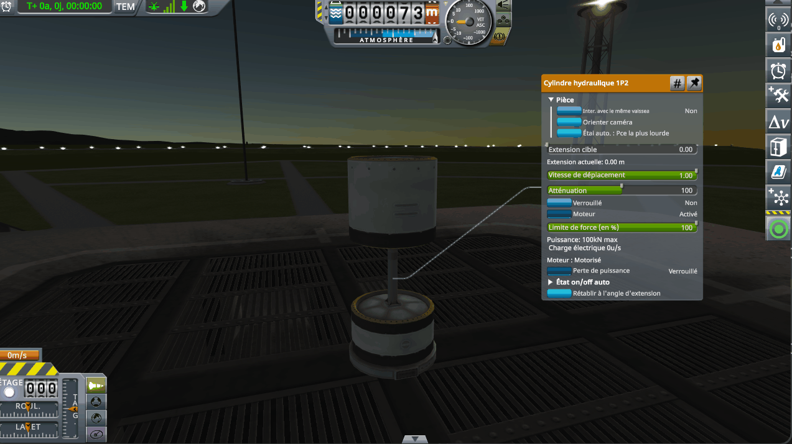
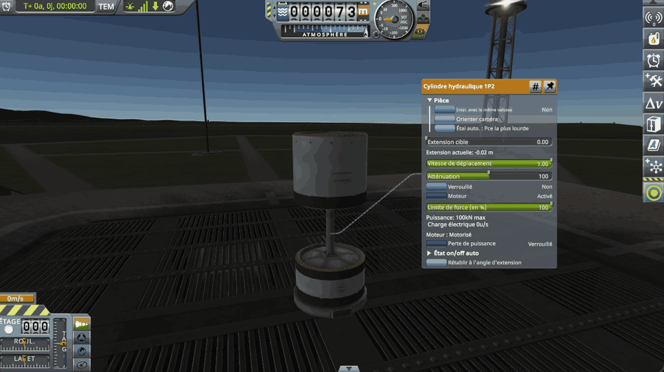
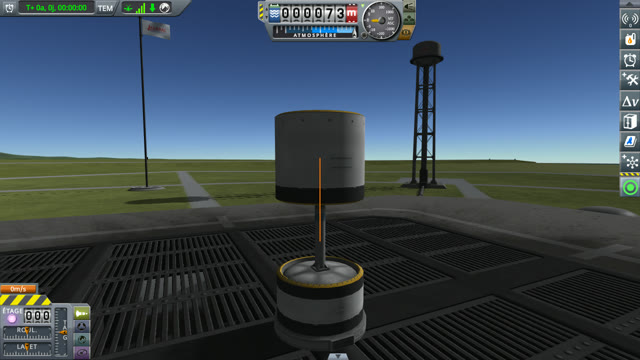
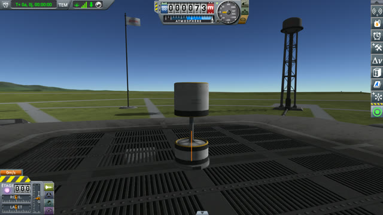

# Auto Strut Pivot Fix

**⚠️ Not finished yet.** This is a new fix, not a finished mod. The code and the conclusions on this page can still change.

A fix for stock KSP 1.12, kept as small as possible: one Harmony postfix, in one source file. It is a mod of its own,
checked on top of [KSP Community Fixes](https://github.com/KSPModdingLibs/KSPCommunityFixes), the base most players run,
and it does not need it. Here is what it fixes:

> **A robotic part set to autostrut to the heaviest part can lock up.** A piston, a hinge or a rotation servo no longer
> moves: its target changes, the part stays where it is. It often starts after a docking: the docked vessel brings the
> heaviest part, and the piston holding the docking port can no longer move it.



*KSP 1.12 with KSP Community Fixes, without this mod, the protocol of [Checking the culprit](#checking-the-culprit).
The game is in French in these GIFs: in the part action window, "Verrouillé : Non" reads "Locked: No",
"Étai auto. : Pce la plus lourde" reads "Autostrut: Heaviest Part", "Extension cible" is "Target extension" and
"Extension actuelle" is "Current extension".*

The autostrut of the robotic part joins both sides of its own pivot: one end on its fixed side, the other on a part
carried by its moving side. See [The culprit](#the-culprit). This mod looks for the heaviest part on the side the
autostrut leaves from instead.

**How this was made.** The investigation and the code were written with Claude, Anthropic's AI
assistant. Everything here was reviewed and validated by a human — me. I am saying so up front, because
contributions made with an AI deserve a closer look than others, and because some people would rather
stop reading here. That look should be quick: the stock code involved is named and quoted on this page, and the fix
is one postfix, in one source file you can read in a few minutes.

## Why it matters

With advanced tweakables on, every part can be autostrutted to the root part, to its grandparent or to the heaviest
part of the vessel. *Heaviest part* is the usual choice to stiffen a robotic arm: the robotic part gets tied to the main
body of the vessel, and stops wobbling.

The heaviest part is looked for again each time the vessel changes: a docking, an undocking, a part breaking off. A
crane whose piston carries a docking port is the typical victim: once it docks to a tanker heavier than itself, the
tanker holds the heaviest part, and the piston is strutted to it, across its own rod. The piston then fights the strut:
the ports can be pushed into each other or pulled apart, the docking joint stretches, and the tanker does not move.

The same happens without a docking, as soon as the heaviest part of the vessel is carried by the moving side of a
robotic part set to *Heaviest part*: a hinge holding a full tank, or a piston that is the root of its vessel. Setting
the autostrut of the robotic part to *Off* frees it.

## The culprit

To find the heaviest part, `Part.GetMassivePart` walks the vessel's tree from the part being strutted, up its parents
(`GetMassiveParentPart`), then down its children (`GetMassiveChildPart`). Each walk stops at an unlocked robotic part,
so that the strut does not cross a pivot that moves. But the test is made on the parts the walk reaches, never on the
part it starts from:

```csharp
// Part.GetMassiveChildPart (KSP 1.12): "original" is the part being strutted, never tested itself
MassivePartCheck(original, part, ref highestPart, ref highestMass, excluded);
if (part.HasFreePivot())
{
    // A free pivot stops the walk down this branch.
    ...
}
else
{
    GetMassiveChildPart(original, part, part.children, ...);
}
```

When the part being strutted is itself an unlocked robotic part, the walk goes straight through its own pivot, and can
pick a part carried by its moving side.

The autostrut, though, does not leave from that side. `Part.SecureAutoStrut` builds it on a node named `"AutoStrut"`,
or on the node of the robotic part that faces its parent. When the heaviest part is found among its children,
`GetMassivePart` takes the node of the downward walk, which is always `null`, so the node keeps the name `"AutoStrut"`.
`PartJoint.SetupJoint` then asks the robotic part which of its rigidbodies holds that node:

```csharp
// BaseServo.AttachServoRigidBody (KSP 1.12)
for (int j = 0; j < attachNodes.Count; j++)
{
    if (attachNodes[j].id == node.id)
    {
        return movingPartRB;
    }
}
return base.part.Rigidbody;
```

No node of the moving side is called `"AutoStrut"`: the strut goes on the fixed side of the robotic part, and ends on a
part carried by its moving side. It holds the two sides of the pivot together, as strong as any autostrut: the motor of
the robotic part cannot beat it.

The *Root part* and *Grandparent part* modes are not affected: their anchor and their node are both on the side of the
parent.

## Checking the culprit

KSP 1.12.5 with the Breaking Ground expansion and [KSP Community Fixes](https://github.com/KSPModdingLibs/KSPCommunityFixes)
1.41.1. The vessel is [Piston-Heaviest.craft](diag/Piston-Heaviest.craft): a 1P2 hydraulic cylinder as its root part,
unlocked, autostrut set to *Heaviest part*; under its base, an empty FL-T100 tank and an RC-001S probe core; on its rod,
a full FL-T200 tank, the heaviest part of the vessel.

1. Copy `Piston-Heaviest.craft` into the `Ships\VAB` folder of a sandbox game, and open that game.
2. In the debug menu (Alt+F12), turn on **Infinite Electricity** in the Cheats screen, so that the piston's power does
   not count.
3. In the VAB, load **Piston-Heaviest** and launch it. It stands on the launch pad.
4. In the part action window of the piston, check that **Locked** reads **No**: a locked piston does not move, with or
   without this mod.
5. Drag **Target extension** slowly up to about **0.2**, and watch **Current extension**.

Without this mod, it can take a few tries: the piston sometimes pushes hard enough to tear the autostrut away, and then
extends. A long stroke asked at once makes it more likely. If the piston extends, revert to launch and try again.

| Without this mod | With this mod |
|---|---|
|  |  |

*After step 5; same vessel, same steps. The game is in French: see the translation under the first GIF of this page.*

- **Without this mod:** the piston does not move, and **Current extension** stays at 0.00 m. Setting the piston's
  autostrut to anything else than *Heaviest part* frees it: it extends at once.
- **With this mod:** the piston extends to its target, and lifts the FL-T200.

The display of autostruts, in the Physics screen of the debug menu, shows where the strut goes: without this mod, from
the piston to the FL-T200, on its rod; with it, from the piston to the probe core, under its base.

| Without this mod | With this mod |
|---|---|
|  |  |

*Same vessel on the launch pad, before touching the piston: an autostrut the piston has torn away is still drawn.*

At `Debug` (see [Settings](#settings)), `KSP.log` gets one line each time the autostrut of a robotic part would have
crossed its pivot:

```
[KSPFixAutoStrutPivot] [DEBUG] Autostrut of piston.02 (…) would cross its own pivot to fuelTankSmall (…): anchored to probeStackSmall (…) instead
```

## The fix

One postfix, with its switch in [Settings](#settings), on by default. Nothing is saved; removing the mod gives the
stock behaviour back at once.

- **`heaviestOnOwnSide`.** A postfix on `Part.GetAutoStrutAnchor`, in flight, for an unlocked robotic part set to
  *Heaviest part*. It works out the rigidbody of the robotic part the autostrut will leave from, the way
  `PartJoint.SetupJoint` will, and the rigidbody that holds the neighbour through which the anchor is reached. When
  they differ, it runs `Part.GetMassivePart` again, with every part on the other side of the pivot left out of the
  candidates, and checks the new anchor the same way. If no part fits, the robotic part gets no autostrut. Locked
  robotic parts, other modes and other parts are left as they are.

Locking or unlocking a robotic part in flight already rebuilds every autostrut of the vessel, so the anchor is always
looked for with the robotic part in its current state.

**Why not drop the autostrut of an unlocked robotic part.** The player chose to stiffen that part. A part on its own
side can hold it without blocking anything: that is what *Heaviest part* is for.

**Why not make the autostrut leave from the moving side.** The strut would no longer cross the pivot, but it would
stiffen what the robotic part carries instead of what holds it, which is not what the player set it for.

## Work in progress

What a player would see if this mod broke something, or what it should fix but was not checked yet, and how to try
it by hand, with the mod and without:

- **A robotic part that is not the root**, a hinge carrying a full tank on its moving side, autostrut set to
  *Heaviest part*: without the mod, the hinge should not move; with it, it should.
- **A crane docking with a piston**: a piston holding a docking port, autostrut set to *Heaviest part*, docks to a
  vessel heavier than the crane. Without the mod, the piston should no longer move the docked vessel; with it, it
  should.
- **Other robotic parts set to *Heaviest part*, nothing heavy beyond their pivot**: with the mod, their autostrut should
  go where it goes on stock (shown by the autostrut display).

## Install

Copy the `GameData\KSPFixAutoStrutPivot` folder into the `GameData` folder of KSP. It needs
[Harmony](https://github.com/KSPModdingLibs/HarmonyKSP), as KSP Community Fixes does. It only acts on the robotic
parts of the Breaking Ground expansion.

## Settings

`GameData\KSPFixAutoStrutPivot\PluginData\settings.cfg` is read once, when KSP starts:

```
// Keeps the autostrut of an unlocked robotic part in Heaviest mode on its own side of its pivot.
heaviestOnOwnSide = True

// How much the mod writes to KSP.log: Error, Warning, Info or Debug.
logLevel = Info
```

- With `heaviestOnOwnSide = False`, nothing is patched: the autostrut goes where the stock code puts it.
- At `Debug`, the mod writes one line each time the autostrut of a robotic part would have crossed its pivot, with
  the part it goes to instead.

## Build

Set `KSPDIR` to the folder of a KSP install with Harmony in its `GameData`, then run `build.bat`: it
compiles `GameData\KSPFixAutoStrutPivot\KSPFixAutoStrutPivot.dll`. Installing is up to you.

## License

[MIT](LICENSE).
